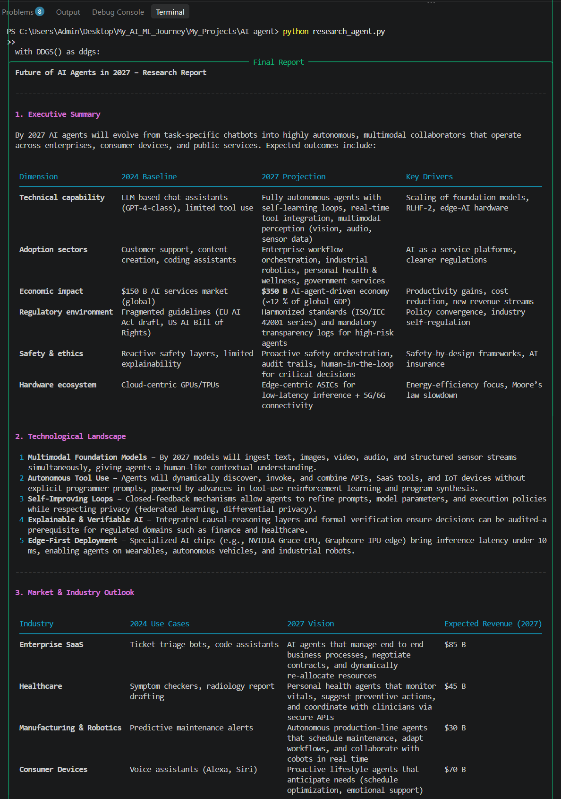
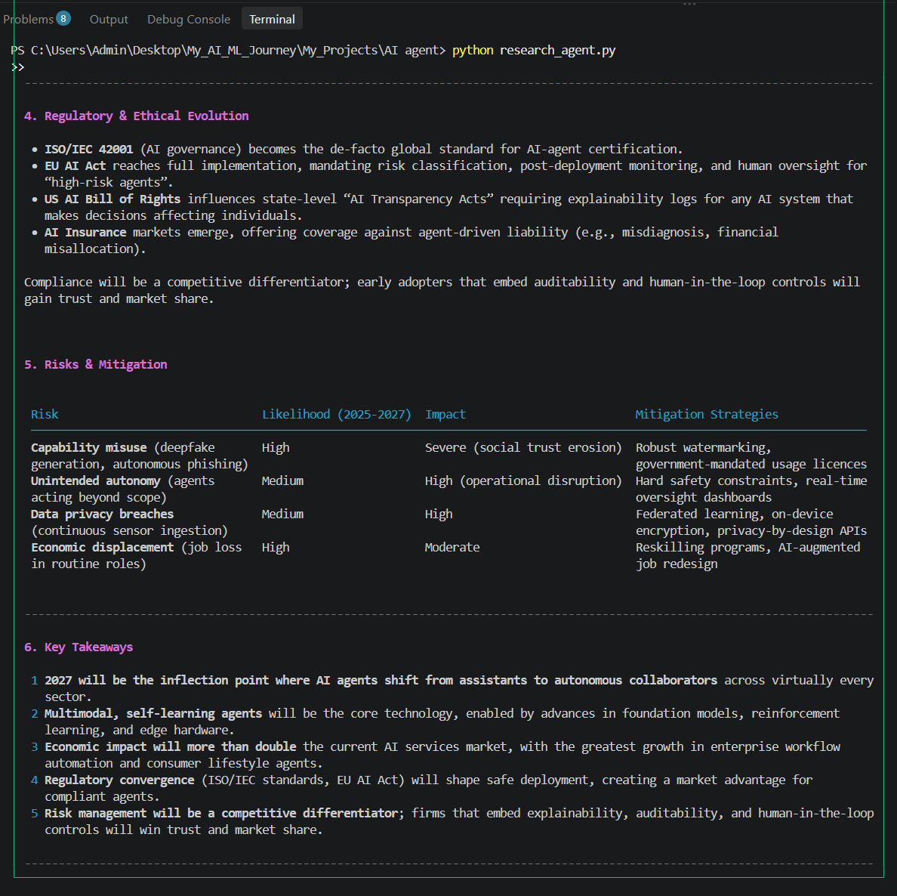
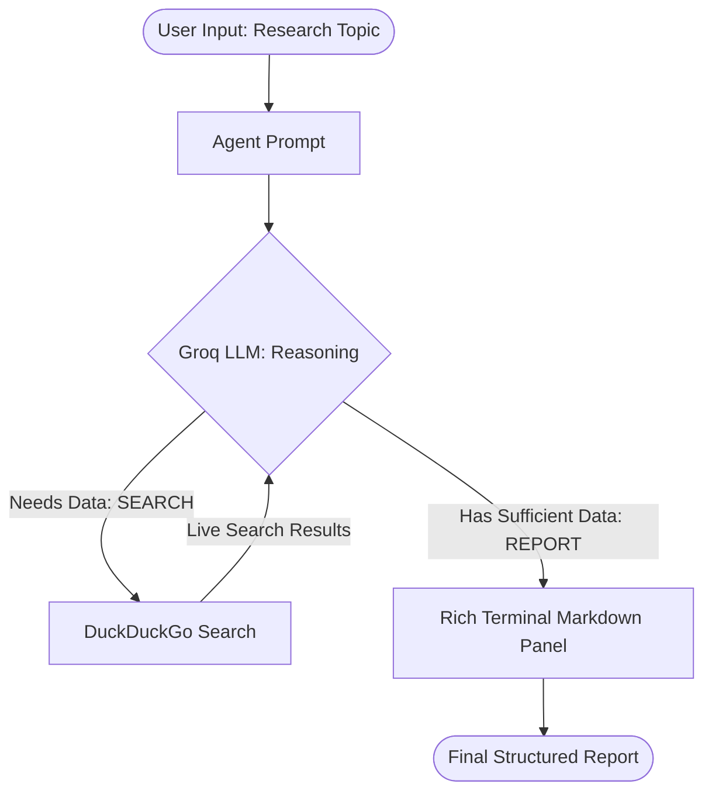

# 🤖 AI Research Agent

> An ultra-fast, autonomous **Deep Research AI Agent** built from scratch in ~40 lines of pure Python using **Groq** and **DuckDuckGo Search**.

[](https://www.python.org/)
[](https://groq.com/)
[](LICENSE)
[](https://github.com/vaibhavv-labs/AI-Research-Agent)

---

## 📸 Live Research Output Preview

### 📊 Part 1: Executive Summary, Baseline & Market Outlook


### 🛡️ Part 2: Regulatory Landscape, Risk Mitigation & Key Takeaways


---

## 📌 Overview

**AI Research Agent** implements the **ReAct (Reasoning + Acting)** pattern to autonomously conduct in-depth web research on any topic. Instead of relying solely on pre-trained LLM knowledge, it queries the live web, analyzes the latest sources, and compiles a comprehensive research brief with structured tables and strategic takeaways.

---

## ✨ Features

- **⚡ Lightning-Fast Inference**: Runs on Groq's LPUs for near-instant responses.
- **🔍 Live Web Scraping & Search**: Autonomously formulates search queries and scrapes DuckDuckGo without requiring expensive Google/Bing API keys.
- **🧠 ReAct Loop**: Seamless cycle of *Thought → Action (Search) → Observation (Read) → Synthesis (Report)*.
- **📊 Rich Terminal UI**: Beautiful formatted markdown reports, status panels, and styled tables powered by `rich`.

---

## 🏗️ Architecture



---

## 📂 Project Structure

```text
AI-Research-Agent/
│
├── assets/
│   ├── demo-part1.png   # Output Preview: Summary & Market Outlook
│   ├── demo-part2.png   # Output Preview: Governance, Risks & Takeaways
│   └── demo.png         # Full continuous report screenshot
│
├── research_agent.py    # Core AI research agent logic (~40 lines)
├── requirements.txt     # Python dependencies
├── .env.example         # Template for environment configuration
├── .gitignore           # Ignores sensitive keys and cache files
└── README.md            # Project documentation
```

---

## 🚀 Quick Start

### 1. Clone the Repository
```bash
git clone https://github.com/vaibhavv-labs/AI-Research-Agent.git
cd AI-Research-Agent
```

### 2. Install Dependencies
```bash
pip install -r requirements.txt
```

### 3. Setup API Key
Create a `.env` file from the template:
```bash
cp .env.example .env
```
Add your free **[Groq API Key](https://console.groq.com/keys)** inside `.env`:
```env
GROQ_API_KEY=your_actual_groq_api_key_here
```

### 4. Run the Agent
```bash
python research_agent.py
```
Enter any topic (e.g., `Future of AI Agents in 2027`, `Quantum Computing Breakthroughs`) and watch the agent autonomously search and compile the report!

---

## 📄 License

This project is licensed under the [MIT License](LICENSE).

---

## 👨‍💻 Author

**Vaibhav Bhoyate**  
- GitHub: [@vaibhavv-labs](https://github.com/vaibhavv-labs)  
- Project Repository: [AI-Research-Agent](https://github.com/vaibhavv-labs/AI-Research-Agent)