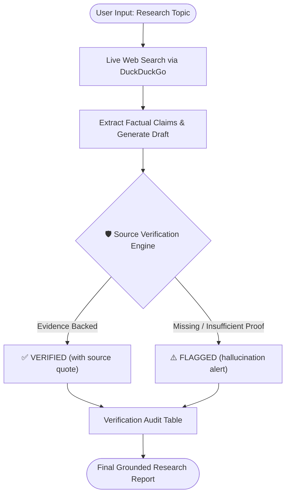

# 🤖 AI Research Agent (v2.0 with Source Verification)

> An ultra-fast, autonomous **Deep Research AI Agent** with **Built-in Source Verification & Hallucination Detection**, built in ~50 lines of pure Python using **Groq** and **DuckDuckGo Search**.

[](https://www.python.org/)
[](https://groq.com/)
[](LICENSE)
[](https://github.com/vaibhavv-labs/AI-Research-Agent)

---

## 🚀 What's New in v2.0: Autonomous Source Verification

In v2.0, the agent doesn't just synthesize search results—it **fact-checks itself** to eliminate hallucinations:

- **🛡️ Cross-Referencing Engine**: Automatically extracts factual claims and matches them against retrieved raw source evidence.
- **✅ `[VERIFIED]` Stamp**: Confirmed facts are tagged with verbatim proof and source attribution.
- **⚠️ `[FLAGGED]` Alert**: Speculative or unbacked claims are proactively flagged with clear warnings instead of being presented as truth.

---

## 📸 Live Research Output Preview

### 📊 Part 1: Executive Summary, Baseline & Market Outlook


### 🛡️ Part 2: Regulatory Landscape, Risk Mitigation & Key Takeaways


---

## 📌 Overview

**AI Research Agent** implements the **ReAct (Reasoning + Acting)** pattern with a dedicated **Verification Critic Loop**. Instead of blindly trusting pre-trained LLM assumptions or unverified snippets, it searches the live web, cross-verifies every claim, and compiles an audit table alongside the final grounded report.

---

## ✨ Features

- **⚡ Lightning-Fast Inference**: Runs on Groq's LPUs (`openai/gpt-oss-120b` / `llama-3.3-70b-versatile`) for sub-second responses.
- **🔍 Zero-Cost Live Web Search**: Autonomously retrieves real-time data using DuckDuckGo without expensive API subscriptions.
- **🛡️ Self-Audit Verification Table**: Audits claims with `✅ VERIFIED` (with quoted proof) and `⚠️ FLAGGED` (hallucination warning).
- **📊 Rich Terminal UI**: Styled markdown reports, comparison tables, and colorful panels powered by `rich`.
- **🪶 Ultra-Lightweight**: Zero heavy frameworks (no LangChain, no LlamaIndex) — just ~50 lines of clean, readable Python.

---

## 🏗️ Architecture (v2.0)



---

## 📂 Project Structure

```text
AI-Research-Agent/
│
├── assets/
│   ├── demo-part1.png   # Output Preview: Summary & Market Outlook
│   ├── demo-part2.png   # Output Preview: Governance, Risks & Takeaways
│   └── demo.png         # Full continuous report screenshot
│
├── research_agent.py    # Core AI research agent + verifier (~50 lines)
├── requirements.txt     # Python dependencies
├── .env.example         # Template for environment configuration
├── .gitignore           # Ignores sensitive keys and cache files
└── README.md            # Project documentation
```

---

## 🚀 Quick Start

### 1. Clone the Repository
```bash
git clone https://github.com/vaibhavv-labs/AI-Research-Agent.git
cd AI-Research-Agent
```

### 2. Install Dependencies
```bash
pip install -r requirements.txt
```

### 3. Setup API Key
Create a `.env` file from the template:
```bash
cp .env.example .env
```
Add your free **[Groq API Key](https://console.groq.com/keys)** inside `.env`:
```env
GROQ_API_KEY=your_actual_groq_api_key_here
```

### 4. Run the Agent
```bash
python research_agent.py
```
Enter any topic (e.g., `DeepSeek V3 model specs`, `Future of AI Agents in 2027`) and watch the agent search, verify sources, and output the report!

---

## 📄 License

This project is licensed under the [MIT License](LICENSE).

---

## 👨‍💻 Author

**Vaibhav Bhoyate**  
- GitHub: [@vaibhavv-labs](https://github.com/vaibhavv-labs)  
- Project Repository: [AI-Research-Agent](https://github.com/vaibhavv-labs/AI-Research-Agent)